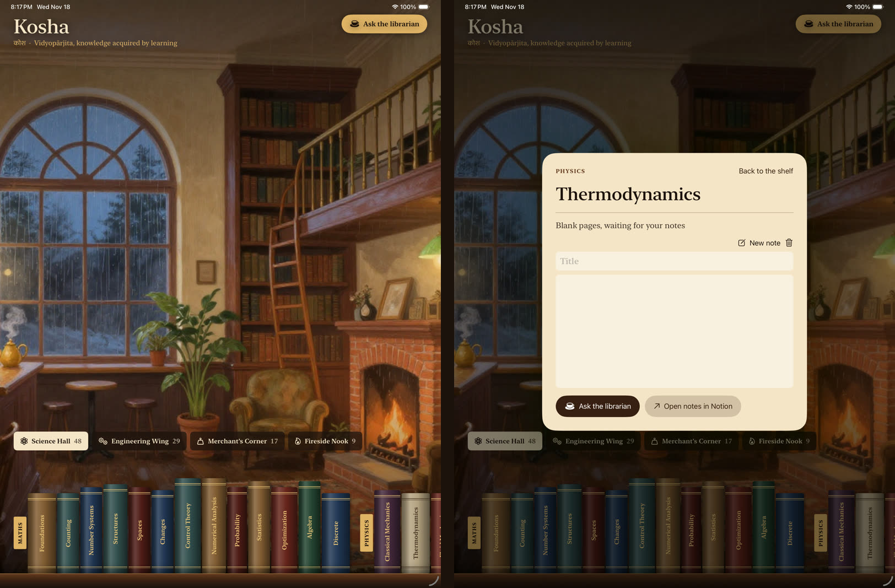

<div align="center">


# Kosha

### A lifetime of learning, on one warm shelf.

A cozy library café for **Mac and iPad**, where every topic you study becomes a **book**, your
notes stay **on your device**, and a **local AI librarian** answers on your Mac.

</div>

<div align="center">

**कोश** (*kosha*) means treasury. Its shelves hold **Vidyopārjita**, knowledge acquired by learning.

[](#-run-it)
[](Kosha/)
[](#-the-librarian)
[](#%EF%B8%8F-roadmap)



</div>

**One evening in Kosha:**

| | You | Kosha |
|---|---|---|
| **1&nbsp;·&nbsp;Browse** | walk into a wing of the library | lays out your topics as books on the shelf |
| **2&nbsp;·&nbsp;Open** | pull a book down | shows what you know about that topic and links to your Notion page |
| **3&nbsp;·&nbsp;Write** | put the idea in your own words | saves your notes automatically, as plain Markdown |
| **4&nbsp;·&nbsp;Ask** | bring your question to the librarian | answers on your Mac, without sending it to a server |

> **A notebook:** pages you fill once and rarely find again.
>
> **Kosha:** a room you want to return to, where what you have learned stays within reach.

## ✨ What you get

| | |
|---|---|
| [**The café**](Kosha/Home/) | a painted, living room with rain on the window, firelight, lamp glow and steam |
| [**The library**](Kosha/Library/) | 103 topics from Vidyopārjita, arranged across four wings |
| [**Your notes**](Kosha/Home/OpenBookView.swift) | a notebook inside every book, with autosave and readable files |
| [**The librarian**](Kosha/Librarian/) | a private tutor that streams answers from a local model on your Mac |

## 🏛️ The library

| Wing | Holds | Books |
|---|---|---:|
| 🔬 **Science Hall** | Maths, Physics, Chemistry, Biology | 48 |
| ⚙️ **Engineering Wing** | Computing, Artificial Intelligence, Automobile, Aerospace | 29 |
| ⚖️ **Merchant's Corner** | Product Thinking, Business, Strategy, Economics | 17 |
| 🔥 **Fireside Nook** | Life, Psychology, Thinking | 9 |

On a Mac, hover to lift a book and click to open it. On iPad, tap once to lift it and tap again to
open it.

## 🧠 The librarian

The librarian runs [`mlx-community/Qwen3-8B-4bit`](https://huggingface.co/mlx-community/Qwen3-8B-4bit)
with [MLX Swift](https://github.com/ml-explore/mlx-swift). Kosha reads the weights from your Hugging
Face cache and does not download them for you.

| | Mac | iPad |
|---|---|---|
| **Browse the library** | ✅ | ✅ |
| **Write notes** | ✅ | ✅ |
| **Ask the librarian** | ✅ | Mac only |

Notes are stored in the app's Application Support folder under `Kosha/Notes`, one Markdown file per
note.

## 🧩 Reusable packages

Note-taking and local model jobs live in
[**Swift-Packages**](https://github.com/hazelwolf/Swift-Packages), so any Swift project can use them.

| Library | What it does |
|---|---|
| **`LocalModelJobs`** | queues local text generation, with streaming and cancellation |
| **`LocalModelMLX`** | runs those jobs on Apple Silicon with MLX Swift |
| **`NoteKit`** | stores notes as Markdown, with anchors, tags, wiki links and search |
| **`NoteKitUI`** | adds a ready-made SwiftUI note editor with autosave |

```swift
.package(url: "https://github.com/hazelwolf/Swift-Packages.git", from: "0.1.0")
```

## 🚀 Run it

You need an Apple Silicon Mac and Xcode 27.2 or later.

**1. Get the code**

```bash
git clone https://github.com/hazelwolf/Kosha.git
```

**2. Install Xcode's Metal Toolchain**

```bash
xcodebuild -downloadComponent MetalToolchain
```

**3. Download the librarian's model** (about 4.3 GB, only needed on the Mac)

```bash
uvx --from huggingface_hub hf download mlx-community/Qwen3-8B-4bit
```

**4. Open the project**

```bash
open Kosha/Kosha.xcodeproj
```

Choose **My Mac** or an iPad simulator, then press **Run**. To install on a physical iPad, choose
your team under **Signing & Capabilities** first.

## 🗺️ Roadmap

| | |
|---|---|
| ✅ **Now** | café homepage, 103 topic books, notes in every book, local librarian on Mac |
| 🔜 **Next** | a first playable lesson: build a ConvNet by hand, then recall it from memory |
| 🌱 **Then** | book states that grow with mastery, daily reviews at the café counter, Notion sync |
| ☁️ **Later** | iCloud sync, with iPad questions answered by your Mac |

## 🗂️ Project map

| Path | Holds |
|---|---|
| [`Kosha/Home/`](Kosha/Home/) | the café scene, shelves, books and open-book screen |
| [`Kosha/Library/`](Kosha/Library/) | wings, shelves and topics |
| [`Kosha/Librarian/`](Kosha/Librarian/) | the librarian conversation |
| [`docs/agents/`](docs/agents/) | how coding agents track issues and use project language |

Work is tracked in [GitHub Issues](https://github.com/hazelwolf/Kosha/issues).

<div align="center">

**Pull up a chair** · the shelves are waiting.

</div>
